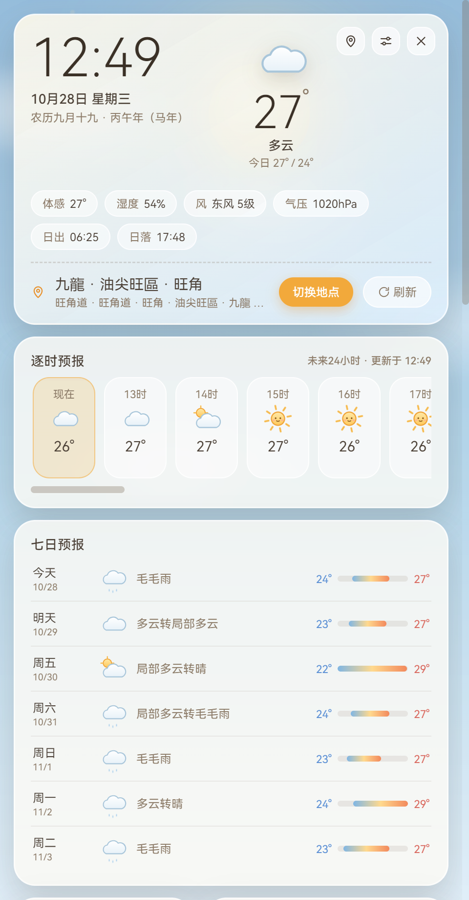

# 云上晴雨天气台

宫崎骏风格的 Windows 桌面天气插件（Electron），透明无边框沉浸式设计。



## 功能特性

- **实时天气**：温度、体感、湿度、风力、气压、能见度，空气质量（PM2.5 / AQI）
- **预报**：未来 24 小时逐时 + 7 日预报，穿衣 / 出行 / 紫外线等生活指数
- **昼夜地球**：3D 自转球体，真实晨昏线与昼夜分布，日出 / 日落 / 月出 / 月落四宫格
  - 鼠标拖拽 360° 旋转球体，昼夜覆盖随视角实时调整，双击复位
  - 时间进度条可拖动，拨动即模拟一天中的任意时刻
  - 「演示自转」（45 秒 / 圈）与「真实自转」一键切换，切回真实自转即全复位
- **万年历**：农历、宜忌、吉日、法定节假日「休 / 班」标注
- **顶部吸附**：拖到屏幕顶端自动收起为温度小窗，悬停展开（可关闭）
- **OTA 在线更新**：后台检查更新，发现新版本横幅提醒，后台下载带进度，重启安装
- 开机自启、窗口置顶、多地点切换、数据本地记忆

## 开发与构建

```bash
npm install        # 安装依赖
npm start          # 开发运行
npm run dist       # 打包 NSIS 安装包 → dist/云上晴雨天气台-Setup-x.y.z.exe
```

数据源（国内直连、免密钥）：[Open-Meteo](https://open-meteo.com)（天气 / 空气）、[Nominatim](https://nominatim.org)（地名）。

## OTA 更新部署

发新版时，把 dist 目录下 **3 个文件**上传到同一个 HTTP(S) 目录（或 GitHub Release）：

| 文件 | 说明 |
| --- | --- |
| `latest.yml` | 更新元数据（版本号、校验和） |
| `云上晴雨天气台-Setup-x.y.z.exe` | 安装包本体 |
| `云上晴雨天气台-Setup-x.y.z.exe.blockmap` | 差分更新块映射（可选，缺失则全量下载） |

用户端两种接入方式：

1. **内置更新源**（推荐）：打包前把 `main.js` 里的 `DEFAULT_UPDATE_URL` 换成该目录地址，用户装好即自动收到更新提醒；
2. **手动配置**：用户在 设置 → 软件更新 里填写更新服务器地址。

检查策略：启动 30 秒后首检，之后每 4 小时后台检查；发现新版本 → 横幅提醒 → 用户点「立即更新」后台下载 → 「立即重启」完成安装。sha512 校验，校验失败自动回退全量下载。

## 作者

**大软子哥哥**

## License

[MIT](LICENSE)
