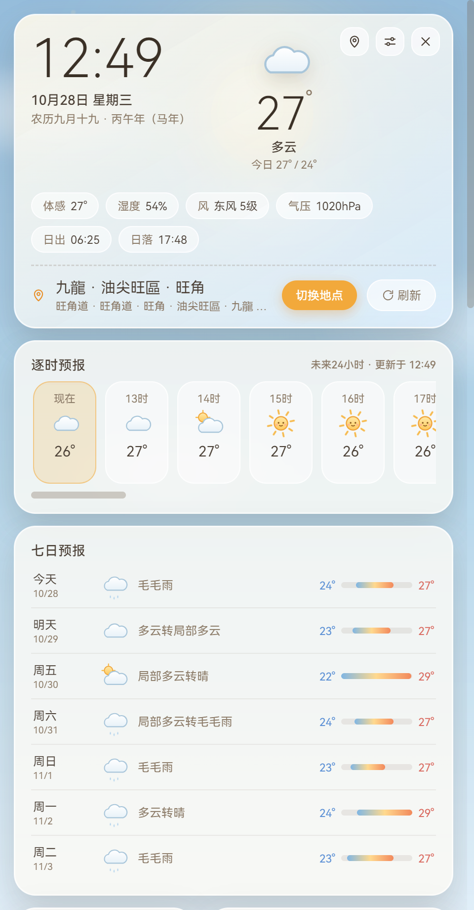

# 🌦 云上晴雨天气台

**宫崎骏风格 Windows 桌面天气插件 · 实时天气 + 昼夜地球 + 万年历 + 吸顶小窗 + OTA 在线更新**

一个透明无边框的桌面天气小部件（Electron）。抬头看天、低头看雨——实时天气、分钟级降水、昼夜地球与万年历都在一块「玻璃」上；拖到屏幕顶端收起成温度小窗常驻桌面，日落后整块界面自动换上星空夜色。



## ✨ 功能一览

### 🌤 天气与预报

- 🌡 **实时天气**：温度、体感、湿度、风力、气压、能见度，空气质量（PM2.5 / AQI）
- 🕐 **预报**：未来 24 小时逐时 + 7 日预报，穿衣 / 出行 / 紫外线等生活指数
- 🌧 **分钟级降水**：未来 2 小时逐 15 分钟降水柱状图，每槽降雨量数值直给（`0.3mm` / `0mm`），无雨槽位长俏皮小草芽 + 智能摘要（「约 X 分钟后开始下雨 / 雨约 X 分钟后停」）
- 📣 **天气提示条**：雷雨 / 降雨 / 降雪点名到具体哪一天；高降水概率自动与该日降水量、天气码交叉校验，按证据强弱措辞，不误报不吓人
- 🚨 **官方预警**：气象局官方预警信号置顶显示（蓝 / 黄 / 橙 / 红分级着色），与自算提示互补不遗漏
- 📈 **温度趋势**：24 小时温度曲线叠加降水概率，横轴带时间刻度与参考线，和逐时卡片逐点对得上；0 概率时刻标「0%」小字一眼可读
- 🌅 **朝晚霞概率**：下一次日出 / 日落的云况评估，绝佳 / 不错 / 一般 / 难见 四档
- 📍 **精准定位**：定位与搜索精确到区县 / 街道，支持多地点切换

### 🌍 昼夜地球

- 🛰 3D 自转球体，真实晨昏线与昼夜分布，日出 / 日落 / 月出 / 月落四宫格（淡彩氛围底色）
- 🖱 鼠标拖拽 360° 旋转球体，昼夜覆盖随视角实时调整，双击复位
- ⏱ 时间进度条可拖动，拨动即模拟一天中的任意时刻
- 🔄 「演示自转」（45 秒 / 圈）与「真实自转」一键切换，切回真实自转即全复位

### 📅 万年历

- 📆 农历、宜忌、吉日
- 🏮 法定节假日「休 / 班」标注（跟随国务院安排）

### 🧩 扩展模块（四联卡）

四组 16 张小卡，每卡独立开关、整组参与排序；卡面带动态光效（光线扫过 / 微粒漂浮 / 水波涟漪 / 星辉月晕 / 雨丝下落 / 雷达扫掠等），跟随系统「减少动态效果」自动静止：

- ☀️ **实时增强**：紫外线防护（WHO 五级 + 防护建议）· 花粉过敏（桦树 / 草 / 豚草三线浓度）· 风力风向罗盘（蒲福风级 + 阵风）· 能见度雾况（五级雾况）
- 👔 **生活指数**：穿衣指数（体感温度六档）· 洗车指数（未来 24h 降水概率）· 晾晒指数（湿度 + 云量）· 感冒指数（昼夜温差风险）
- 🌗 **日月气候**：月相与日出日落（月龄推算 + 农历 + 日照进度条）· 历史今天对比（近 10 年同日均温）· 周月降水统计 · 气压趋势（24h 曲线 + 3h 变化）
- 🎮 **玩法效率**：多城市关注（收藏城市实况一览、一键切换）· 降水雷达图（卫星底图 + RainViewer 回波 + vivo 式底部时间轴拖动 / 播放暂停 + 雨情文案 + 真扫掠动效 + 外推）· 自定义天气提醒（降雨 / 高低温 / 紫外线 / 大风规则，系统通知）· 天气卡片分享（天气卡一键生成保存）
- 🔗 **点击看详情**：带 ↗ 角标的数据卡（紫外线 / 风力 / 能见度 / 穿衣 / 洗车 / 晾晒 / 感冒 / 降水统计 / 气压 / 月相 / 雷达）点击即跳网页看实况详情——UV、风、能见度、温度、降水、气压直达 Windy 对应图层，月相到 timeanddate，雷达到 RainViewer；跟随当前城市定位，白名单域名保护

### 🪟 桌面体验

- 📌 **顶部吸附**：拖到屏幕顶端自动收起为温度小窗，悬停展开；小窗位置跟随大窗平移，重启按记忆还原；小窗是「桌面部件」——平时待在所有程序窗口后面不遮挡任何程序，Win+D / 任务栏「显示桌面」时随壁纸浮出、始终不消失
- 🌙 **夜色星空主题**：按当地日出日落自动切换深色星空配色，日出自动恢复
- 🌡 **托盘温度**：系统托盘实时显示当前温度，昼夜配色自动切换
- 📣 **天气早晚报**：每天 8:00 / 20:00 系统通知播报天气与带伞提醒（可关闭）
- ⚡ 开机自启、窗口置顶、数据本地记忆
- 🧩 **模块开关与排序**：昼夜地球 / 逐时预报 / 七日预报 / 空气质量 / 生活指南 / 万年历 均可独立开关，另有 16 张扩展四联卡（整组排序、组内单控）；按住 ≡ 手柄拖动即可排序，界面随你排
- 🖱 **沉浸式滚动**：界面不显示侧边滑块，滚轮一格约 3 行平滑跟进（触控板高精度跟手），或按住上下拖拽顺滑滚屏，松手带惯性手感

### 🔄 OTA 在线更新

- 📡 启动 30 秒后首检，之后每 4 小时后台检查
- 🆕 发现新版本横幅提醒 →「立即更新」后台下载 →「立即重启」完成安装
- ✅ sha512 校验，校验失败自动回退全量下载

## 📋 目录

- [功能一览](#-功能一览)
- [快速开始](#-快速开始)
  - [下载安装](#下载安装)
  - [开发与构建](#开发与构建)
  - [OTA 更新部署](#ota-更新部署)
- [目录结构](#-目录结构)
- [常见说明](#-常见说明)
- [致谢](#-致谢)
- [免责声明](#️-免责声明)

## 🚀 快速开始

### 下载安装

前往 [Releases](https://github.com/kmnn111/sky-weather-widget/releases) 下载最新的 `SkyWeather-Setup-x.y.z.exe`，双击安装即可。装好后常驻托盘，可在设置里开关开机自启、窗口置顶。

### 开发与构建

```
git clone https://github.com/kmnn111/sky-weather-widget.git
cd sky-weather-widget
npm install        # 安装依赖
npm start          # 开发运行
npm run dist       # 打包 NSIS 安装包 → dist/云上晴雨天气台-Setup-x.y.z.exe
```

数据源（国内直连、免密钥）：

- **国内源优先**（对齐主流手机厂商天气 App 的数据口径）：[中国天气网](http://www.weather.com.cn)（实况 / 7 天预报 / 日出日落 / 官方预警 / 生活指数）+ itboy 天气聚合（7 天 / 空气质量），失败自动降级海外源；界面「来源」行**分段如实标注**（实况 / 7 天 / 空气 / 逐时 / 预警各段来自谁，悬停看明细），国内源是否生效一目了然；
- **海外源补充**（国内无免密钥接口的字段）：[Open-Meteo](https://open-meteo.com)（逐时 / 分钟级 / UV / 花粉 / 历史归档）、[Nominatim](https://nominatim.org)（地名搜索 / 逆地理）、[RainViewer](https://www.rainviewer.com)（降水雷达回波）。
- **网络环境适配**：国内源走国内 CDN（实测毫秒级）；境外源慢/不可达（部分移动宽带直连场景）时自动降级不阻塞——地名搜索改为**双源并行合并 + 智能排序**（精确名 > 行政级别 > 人口，外地同名小村镇自动降权），并以中国天气网地名库的拼音做**二次召回**（如搜「慈溪」不会再冒出安徽/广西同名小村）；自动定位采用 **IP 三源投票**（ip-api + pconline 国内库 + ipwho.is）取最深名字链再精化坐标，能到区县不糊弄成地级市。换网络后跑 `node probe-net.js` 可一键诊断各数据源可达性。

### OTA 更新部署

发新版时，把 dist 目录下 **3 个文件**上传到同一个 HTTP(S) 目录（或 GitHub Release）：

| 文件 | 说明 |
| --- | --- |
| `latest.yml` | 更新元数据（版本号、校验和） |
| `SkyWeather-Setup-x.y.z.exe` | 安装包本体 |
| `SkyWeather-Setup-x.y.z.exe.blockmap` | 差分更新块映射（可选，缺失则全量下载） |

> 用 GitHub Release 作更新源时，资产名请使用 ASCII（如 `SkyWeather-Setup-x.y.z.exe`）——中文文件名在 `/releases/latest/download/` 直链下会 404。仓库脚本产出的 `dist-gh/` 即为可直接上传的 ASCII 三件套。

用户端两种接入方式：

1. **内置更新源**（推荐）：`main.js` 的 `DEFAULT_UPDATE_URL` 已内置 GitHub Releases 直链，装好即自动收到更新提醒（也可打包前改为自己的目录地址）；
2. **手动配置**：在 设置 → 软件更新 里填写更新服务器地址。

## 📁 目录结构

```
sky-weather-widget/
├── main.js             # 主进程：窗口 / 吸顶小窗 / 托盘 / OTA / IPC
├── preload.js          # 上下文桥接
├── geo.js              # 数据层：地名 / 网络重试兜底
├── cn-source.js        # 国内源：中国天气网 + itboy（归一化合并 / 天气码映射）
├── renderer/
│   ├── index.html
│   ├── app.js          # UI 渲染与交互（惯性滚动、窗口拖拽）
│   ├── fx.js           # 天气动画（日月云星）
│   ├── globe.js        # 昼夜地球（SVG 球体 + 晨昏线）
│   ├── lunar.js        # 万年历（农历 / 宜忌 / 节假日）
│   ├── weather.js      # 天气数据解析与展示
│   ├── icons.js        # 天气图标
│   └── styles.css      # 宫崎骏风格主题（含夜色星空）
├── assets/             # 图标与字体
├── scripts/            # 构建与发版脚本
├── fake-ota-server.js  # 本地假 OTA 源（更新链路自检用）
├── probe-net.js        # 数据源网络诊断（换网络后跑一遍即知各源状况）
└── dist/               # npm run dist 产物（安装包 + latest.yml）
```

## 📝 常见说明

- **小窗记忆**：吸顶小窗位置跟随大窗平移自动对位，重启后按记忆位置还原。
- **小窗常驻**：吸顶小窗是「桌面部件」——平时钉在壁纸层上方、待在所有程序窗口后面（不遮挡浏览器等任何程序），「显示桌面」（Win+D / 任务栏右下角小竖条）时随壁纸层一起浮出、始终不消失；打开「窗口置顶」开关则小窗常驻最上层（浮在程序之上）。大窗态保持系统正常最小化行为。
- **夜色切换**：按当地日出日落精确翻转（以天气数据 sunrise / sunset 为准），不按固定钟点猜。
- **更新横幅**：点「稍后」后同一版本只提醒一次；设置 → 软件更新 里可随时手动检查，已下载的更新可「立即重启」安装。
- **调试自检**：`--shot` / `--shot-globe` / `--shot-update` / `--shot-dock` 为开发自检入口，日常使用无需关心。

## 🙏 致谢

- [Open-Meteo](https://open-meteo.com) — 免费开源的天气 / 空气质量 API
- [OpenStreetMap Nominatim](https://nominatim.org) — 地名检索
- [lunar-javascript](https://github.com/6tail/lunar-javascript) — 农历与法定节假日
- [Electron](https://www.electronjs.org) / [electron-builder](https://www.electron.build) — 桌面壳与在线更新
- **许斌** — 认真试用与反馈（数据来源显示、搜索与定位的宝贵意见）

## ⚠️ 免责声明

本项目为个人自用工具，仅供学习交流，请勿用于商业用途。天气、空气与地名数据来自第三方公开接口（中国天气网、Open-Meteo、OpenStreetMap、RainViewer 等），其准确性与可用性以数据源为准。使用本项目产生的任何问题由使用者自行承担。

---

**作者：大软子哥哥** · 如果对你有帮助，欢迎点个 ⭐ Star
